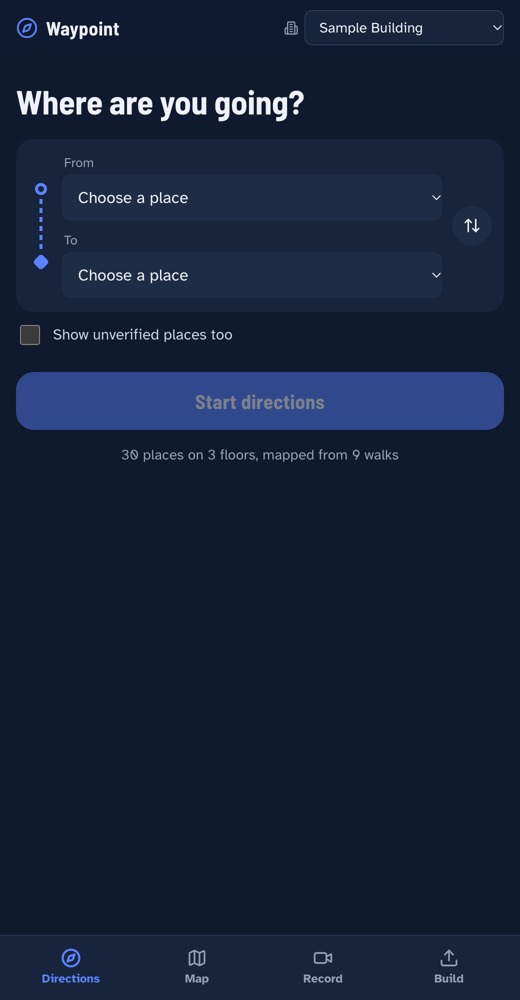
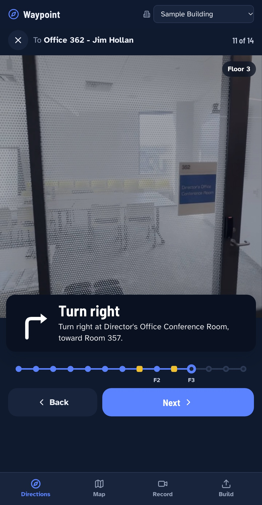
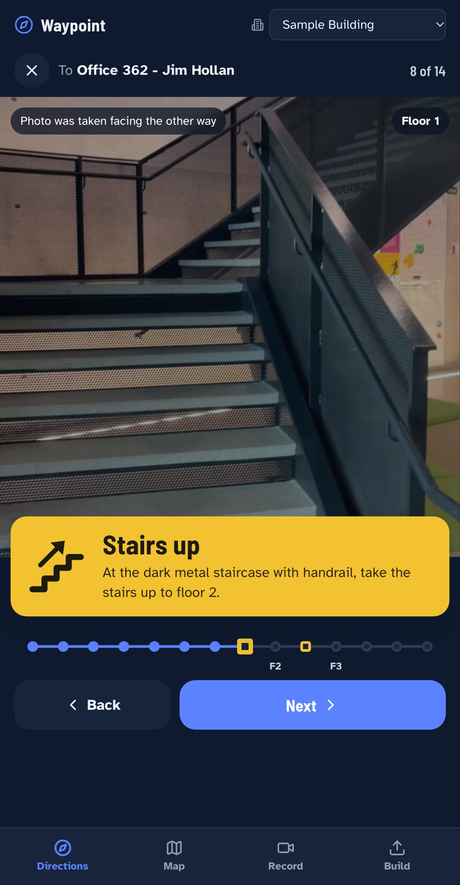
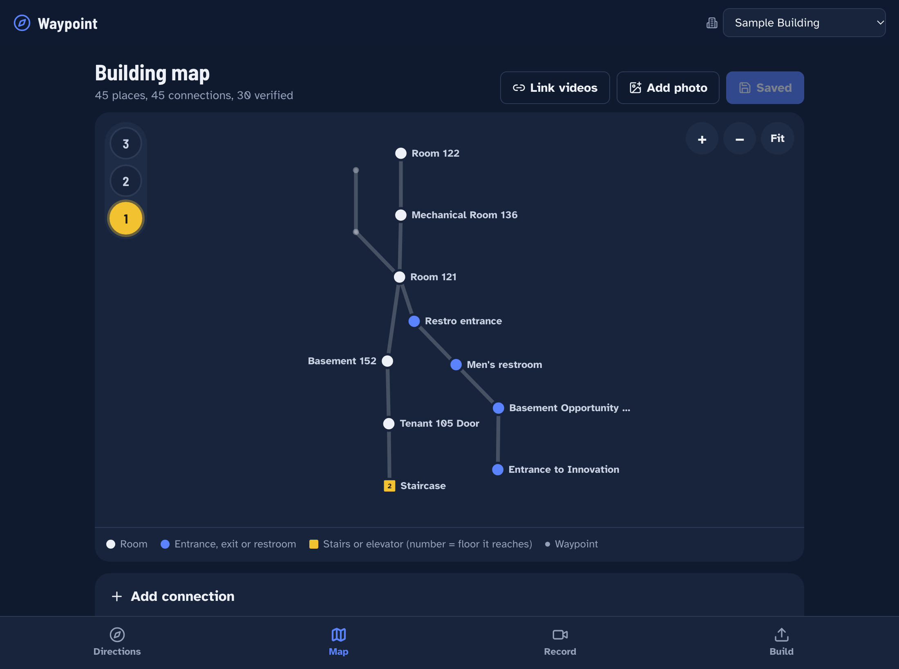
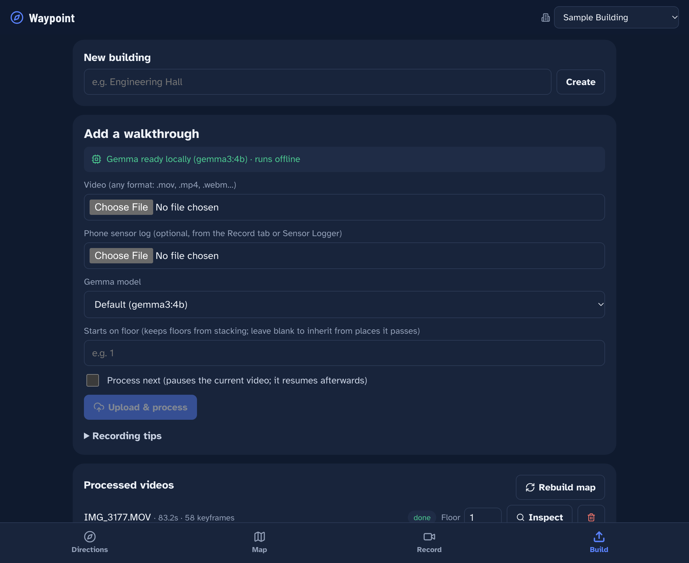

# Waypoint: indoor navigation from a walkthrough video

Record a walk through a building on a phone and upload it. The app merges all your walks into one multi-floor navigation map. Users pick *From* and *To* on their phone and follow step-by-step photos with wayfinding arrows.

- **Gemma runs locally and offline** (or optionally a hosted Gemini model) to read door plaques and signs.
- **On-device OCR** checks every word Gemma reports, so the model cannot invent room numbers.
- **Computer vision** (plus the phone gyro, when available) finds every turn, glance and staircase.
- **Routing is pure graph math.** No model is called when a user asks for directions.
- **Access is invite-only** by default.

<p align="center">
  
  
  
</p>

<p align="center"><em>Plan a trip, follow photo-and-sign steps, and change floors on the way.</em></p>

<p align="center">
  
</p>

<p align="center"><em>One map per floor, built from every walkthrough video. Stairs show the floor they reach.</em></p>

<p align="center">
  
</p>

<p align="center"><em>Upload or record walks; a pausable queue processes them locally.</em></p>

## Contents
- [How it works](#how-it-works)
- [Features](#features)
- [AI models](#ai-models)
- [Run it](#run-it)
- [Share over the internet](#share-over-the-internet)
- [Sharing and access](#sharing-and-access)
- [Configuration](#configuration)
- [Tests and evaluation](#tests-and-evaluation)
- [Recording tips](#recording-tips)
- [Persistence](#persistence)
- [Contributors](#contributors)

## How it works

```
video ─ffmpeg─▶ analysis.mp4 (10 fps) ─optical flow / gyro─▶ travel heading ─▶ turns / glances / pauses
       └──────▶ hq.mp4 (15 fps) ─adaptive sharpness─▶ keyframes ─OCR + Gemma─▶ signs, rooms, stairs
                                                         │
     walk nodes ─▶ loop closure ─▶ floors (start floor, room numbers, stairs) ─▶ link all videos ─▶ map.json
```

| Stage | What happens |
|---|---|
| **Normalize** | ffmpeg converts any input (iPhone HEVC `.MOV` with rotation, WebM, MP4) to constant-frame-rate H.264 with rotation applied. |
| **Motion** | Lucas–Kanade corners and a RANSAC similarity fit. Horizontal shift gives **yaw**; expansion gives **forward motion**. The **travel heading** is a running median over frames that move forward, so looking around never counts as a turn. A phone gyro log, when attached, replaces vision yaw. |
| **Events** | *Turn*: a sustained change in travel heading. *Glance*: the camera points more than 35° off the travel direction (usually at a plaque). *Pause*: the camera is nearly still. |
| **Keyframes** | Event-driven (before and after turns, glances, pauses, scene changes, plus a 3 s heartbeat). In each ±0.5 s window the sharpest frame is kept. Blurry windows keep their best frame, flagged `soft`, so no place is lost. |
| **OCR + Gemma** | OCR lists the text really present. Gemma returns structured JSON (sign text, room numbers, label, place type, stairs, floor, landmark phrase) and may only copy text from that list. Answers are cached on disk. See [How Gemma answers are checked](#how-gemma-answers-are-checked). |
| **Mapping** | Turns, pauses, signs and stair boundaries become nodes. Revisits are found by room number and ORB homography, then verified. Places with different plaque numbers never merge. Edge headings snap to the building's dominant axis. |
| **Floors** | Floors start at 1 and come from the start floor, confirmed room numbers, floor signs and detected stairs. See [How floors work](#how-floors-work). |
| **One map from n videos** | Same room number or named sign on the same floor means same place, even when walked in opposite directions. Strong image matches across walks merge too. Unanchored walks are rotated into the building frame. |
| **Routing** | `turn = heading_out(next) − heading_in(arrival)`, quantized to straight, slight, turn or u-turn. A walk works in both directions. Floor changes say "take the stairs up to floor 2". Each step shows the photo taken while approaching that point in your direction of travel. |
| **App** | Directions: full-bleed photo with a wayfinding sign and a route strip. Map: per-floor schematic with a floor selector, pan and zoom, merge review and editing. Build: pausable processing queue (run next, resume, survives restarts), per-video start floor, video removal. |

## Features

- **Trip planner and step-by-step directions**, with photo-and-sign steps and floor changes.
- **Step-free routing.** `avoid_stairs` uses only flat walks, ramps and elevators. Every route says whether it is step-free.
- **Shareable route links**, for example `#/navigate?b=<building-id>&from=<place-id>&to=<place-id>`.
- **Measured distances**, shortest-walk routing and a 3D map view.
- **Build tab** with a pausable processing queue and upload or in-browser recording.
- **Problem reports.** Visitors can report a wrong sign, direction or place from the app. Editors review them in the Build tab and set a status with an optional resolution note. Reporting is rate-limited.
- **Entrance posters.** A printable poster with a QR code for a viewer link, opened from the share panel.
- **Invite-only access** with an owner key, invite links and roles.
- **Share script** `scripts/share.sh` for a Cloudflare tunnel, so phones can reach the app over HTTPS.
- **Batch CLI** for ingesting, routing, rebuilding and inviting without the UI.
- **Evaluation harness** that scores the whole pipeline on synthetic buildings with known ground truth.

## AI models

**Used by the app (run locally, offline after one download):**

| Model | Role |
|---|---|
| **Gemma 3 4B** (`gemma3:4b`, Google, open weights, via Ollama) | Default vision-language model. Per keyframe it returns structured JSON. It also answers "same place?" and "same stairwell?" when linking walks and floors. |
| **Gemma 3 12B** (`gemma3:12b`, optional) | Higher quality, about 2.5× slower. For overnight pre-processing on machines with 32 GB+. |
| **Apple Vision text recognizer** (macOS, on-device) | OCR engine on macOS. Grounds Gemma: only text this OCR found may become a sign or room number. |
| **RapidOCR** (PP-OCRv5 ONNX models on onnxruntime) | OCR engine on Linux and Windows. Install with `uv sync --extra linux-ocr`. |
| **Gemini** (`gemini-2.5-flash-lite` by default, optional, **hosted**) | Can replace local Gemma. Photos leave the machine and each call costs money. See [Hosted vision](#hosted-vision-optional). |

Everything else is classical computer vision with no learned model: Lucas–Kanade optical flow, RANSAC similarity fits, ORB features and homographies (OpenCV), plus graph search (NetworkX).

**Speed.** Tested with `gemma3:4b`: about 5 s per keyframe on Apple Silicon at concurrency 3 (`GEMMA_CONCURRENCY`). Each upload can name its own model (the `model` form field, or `--model` in the CLI). That model is used for every Gemma call on the walk.

**Built with:** the architecture, pipeline, backend, frontend, tests and this README were designed and implemented with **Claude Opus 5.5** (Anthropic, model ID `claude-opus-5-5`) in **Claude Code**. The team chose the building, recorded and curated the walkthroughs, tested on site and directed the design.

## Run it

```bash
# one-time setup (needs internet once)
brew install ffmpeg uv cloudflared ollama
ollama pull gemma3:4b            # fast default; gemma3:12b for higher-quality pre-processing

# 1. local model server (parallel requests ~25% faster on Apple Silicon)
OLLAMA_NUM_PARALLEL=4 ollama serve

# 2. backend (serves the API and the built frontend on :8000)
#    first start prints your owner key once in the log: copy it somewhere safe
cd backend && uv sync && uv run uvicorn app.main:app --host 0.0.0.0 --port 8000

# 3. frontend: build once into backend/static ...
cd frontend && npm install && npm run build
#    ... or develop with hot reload on :5173 (proxies /api to :8000)
npm run dev
```

Check the local model with `curl http://localhost:8000/api/health`. `gemma.ok` is true when Ollama answers, and `gemma.selected` is the model in use. If Ollama is stopped, the reply comes back within a few seconds with `ok: false`.

Open the app on your device. It asks for an invite link or the owner key before it shows anything. See [Sharing and access](#sharing-and-access).

Linux: use `uv sync --extra linux-ocr` in step 2 for RapidOCR.

### Batch pre-processing (no UI)
```bash
cd backend
uv run python -m app.cli ingest "Sample Building" ../IMG_31*.MOV
uv run python -m app.cli route sample-building n001 n012
uv run python -m app.cli route sample-building n001 n012 --avoid-stairs   # only flat walks, ramps and elevators
uv run python -m app.cli rebuild sample-building   # re-run CV + mapping; Gemma answers come from cache
# add --model gemma3:12b to ingest for a slower, higher-quality run
# add --model gemini-2.5-flash-lite to ingest for the hosted model (see Hosted vision)
```

## Share over the internet

`scripts/share.sh` starts the backend and Ollama if needed, then opens a Cloudflare tunnel. Use it to reach the app on a phone (camera and gyro need HTTPS on iOS).

```bash
scripts/share.sh            # start (quick mode unless a named tunnel is configured)
scripts/share.sh --build    # rebuild the frontend first; needed once, and after frontend changes
```

- **Quick mode (default, no account):** a random `https://<words>.trycloudflare.com` address. It changes on every restart.
- **Named mode:** a stable address on your own domain. Set `TUNNEL_NAME` and `TUNNEL_HOSTNAME` in the environment or in `scripts/share.env` (copy `scripts/share.env.example`; gitignored). Setting only one is an error. Full steps are in `scripts/README.md`.

Logs go to `logs/` (gitignored). Press Ctrl-C to stop everything the script started.

**Never run with `AUTH_REQUIRED=0` behind a tunnel.** Tunnel traffic reaches the server from 127.0.0.1, so it looks local.

## Sharing and access

Access control is on by default. Nobody can see or change a building without the owner key or an invite link.

- **Owner key.** One per server. It opens every building, creates buildings and makes invite links.
- **Invite link.** One per person per building. It opens that one building, with the role you give it.

Photos are served through signed links that last `FRAME_URL_TTL_SEC` (one day by default).

### Find the owner key (first start)
On first start the backend makes an owner key and prints it once:

```
OWNER KEY, shown only once: <key>
```

Copy it now. The server keeps only a SHA-256 hash, in `backend/data/auth.json`. If you lose the key, rotate it. The old key stops working at once:

```bash
cd backend && uv run python -m app.cli owner-key --rotate
```

To choose your own key, set `ADMIN_TOKEN` (at least 24 characters) before the first start:

```bash
ADMIN_TOKEN="$(python3 -c 'import secrets; print(secrets.token_urlsafe(32))')" \
  uv run uvicorn app.main:app --host 0.0.0.0 --port 8000
```

While `ADMIN_TOKEN` is set, `--rotate` refuses to run. Change the variable instead. To see where the key comes from (the key itself is never printed): `uv run python -m app.cli owner-key`.

### Open the app as owner
1. On the access screen, tap **I own this server**, paste the owner key and tap **Save owner key**.
2. The app now lists every building. The key is saved in this browser only.

### Invite someone

| Role | Can do |
|---|---|
| **Viewer** | Get directions and plan routes. Read the map, but change nothing. |
| **Editor** | Everything a viewer can, plus add walks, record, review and edit the map, and rebuild. |

Only the owner makes invites.

**In the app:** open the building, go to **Build**, find **Share this building**, pick the role, add an optional label and tap **Create link**. The link is shown once.

**From the command line:**
```bash
cd backend
uv run python -m app.cli invite sample-building --role viewer --label "Front desk"
uv run python -m app.cli invite sample-building --role editor --label "Alex"
```

The command prints a join path such as `#/join?b=sample-building&t=...`. Put your server address in front of it, and send the link. The person opens it on their phone. No account is needed.

### Revoke a link
In **Build**, under **Invite links**, tap **Revoke**, then **Yes, revoke**. Or from the command line:
```bash
cd backend
uv run python -m app.cli invites sample-building                    # lists invite ids (no codes)
uv run python -m app.cli revoke sample-building <invite_id>
```

A revoked link stops at once, and its photo links stop working too.

### What a visitor without access sees
An access screen and no buildings. The visitor can paste an invite link, or tap **I own this server** and enter the owner key. To remove saved links and the owner key from a shared device, use **Sign out on this device** in the top bar. **Forget this building** removes only the link for the building on screen.

With access control on, `/docs` and `/openapi.json` are turned off.

### Known limits
- **Invite links do not expire.** A link works until its owner revokes it.
- **A link is a key.** Send it only to the person it is for, and never post it publicly.
- **The owner key opens everything.** The first-start log holds it in clear text, so keep that log private.

## Configuration
Every setting has a default and can be overridden with an environment variable, for example `MAX_UPLOAD_MB=4096 uv run uvicorn app.main:app --port 8000`. The full list is in `backend/app/config.py`.

### Access and uploads
| Variable | Default | What it does |
|---|---|---|
| `DATA_DIR` | `backend/data` | Where buildings and `auth.json` (owner key hash, photo-link signing secret) are kept. |
| `AUTH_REQUIRED` | 1 | Access control. `0` turns it off, for local development only. |
| `ADMIN_TOKEN` | unset | Your own owner key, at least 24 characters. Unset: a key is made on first start. |
| `FRAME_URL_TTL_SEC` | 86400 | How long a signed photo link works, in seconds. |
| `AUTH_MAX_FAILS` | 20 | Failed access attempts per address per minute. One more gets HTTP 429. |
| `MAX_UPLOAD_MB` | 2048 | Largest walk video, in MiB. Bigger gets HTTP 413. |
| `MAX_SENSOR_BYTES` | 52428800 (50 MiB) | Largest `sensors.json` sent with a video. Bigger gets HTTP 413. |
| `MAX_IMAGE_BYTES` | 26214400 (25 MiB) | Largest manually added photo. Bigger gets HTTP 413. |

### Local Gemma and OCR
| Variable | Default | What it does |
|---|---|---|
| `GEMMA_MODEL` | gemma3:4b | Model used when an upload names none. `gemma3:12b` is slower and more accurate. |
| `GEMMA_KEEP_ALIVE` | 30m | How long Ollama keeps the model loaded. Also `1h`, or seconds (`-1` = forever). |
| `GEMMA_NUM_CTX` | 4096 | Context size sent with every request, so the loaded model is reused. |
| `GEMMA_NUM_PREDICT_ANALYZE` | 512 | Answer token cap for frame analysis. A truncated answer fails the call. |
| `GEMMA_NUM_PREDICT_COMPARE` | 320 | Answer token cap for "same place?" and "same stairwell?". |
| `GEMMA_LIST_TIMEOUT_SEC` | 3 | Timeout for model list, model check and health calls, so a stopped Ollama fails fast. |
| `GEMMA_BREAKER_FAILS` | 3 | Failures in a row before the rest of the walk uses cached answers only. |
| `OCR_ENGINE` | auto | `auto`, `vision` (macOS), `rapidocr` (Linux/Windows) or `none`. `auto` picks Vision on macOS, else RapidOCR if installed, else none. |
| `OCR_ENABLED` | 1 | Master switch. `0` turns OCR off whatever the engine. |

### Hosted vision (optional)
| Variable | Default | What it does |
|---|---|---|
| `VISION_PROVIDER` | auto | `auto`, `gemma` (local only) or `hosted` (Gemini only). |
| `GEMINI_API_KEY` | unset | Key for the hosted Gemini model. Set it in the environment only, never in a file. Unset: no hosted calls. |
| `HOSTED_MODEL` | gemini-2.5-flash-lite | Gemini model for hosted walks. Must start with `gemini`. |
| `HOSTED_MAX_CALLS_PER_DAY` | 5000 | Cost guard: most Gemini requests per server per UTC day. |
| `HOSTED_TIMEOUT_SEC` | 60 | Timeout for one Gemini request. |
| `HOSTED_CHECK_TIMEOUT_SEC` | 5 | Timeout for the reachability check. |
| `HOSTED_CHECK_TTL_SEC` | 300 | How long a reachability result is reused. |
| `HOSTED_RETRY_MAX_SEC` | 10 | Longest server `Retry-After` wait before the one retry. |
| `HOSTED_CONCURRENCY` | 4 | Frames sent at once for a hosted walk. |

- **Privacy and cost.** Hosted walk photos leave your machine and go to Google. Use it only if you accept both.
- **`auto` (default).** A new walk uses `HOSTED_MODEL` when `GEMINI_API_KEY` is set, the API answers and today's calls are under `HOSTED_MAX_CALLS_PER_DAY`. Otherwise the walk uses local Gemma. Each walk picks its model once.
- **`gemma`.** Local only. The hosted API is never called.
- **`hosted`.** Always Gemini. Fails if `GEMINI_API_KEY` is missing.
- **An explicit model wins.** An upload's `model` field, or `--model gemini-...` on the CLI, selects that model.
- **Retries.** One retry after a network error, HTTP 429, a 5xx or an unreadable answer. Other 4xx errors do not retry.
- **Call count** is kept in `backend/data/hosted_usage.json`, shared by all walks on the server. The key is never logged or shown by `/api/health`.

### Floors and stairs
| Variable | Default | What it does |
|---|---|---|
| `MAX_FLOOR` | 9 | Highest floor number. `start_floor` must be 1 to this value. |
| `FLOOR_SIGNS` | 1 | Set to `0` to ignore floor signs and Gemma's floor hints. |
| `FLOOR_SIGN_WEIGHT` | 2.0 | Evidence weight of one OCR-confirmed floor sign. A room number weighs 1, and a floor needs 2. |
| `STAIR_LANDING_GAP_S` | 9.0 | Longest gap (seconds) between two same-direction flights that can still be one climb. **Untuned guess: tune on real walks.** |
| `STAIR_LANDING_MAX_S` | 15.0 | Longer gap, allowed only when every frame between is a stairwell. **Untuned guess: tune on real walks.** |

Set both `STAIR_LANDING_*` values to `0` to count every flight as a floor change.

### Gemma calls and failures
- Every call uses temperature 0 and the `GEMMA_NUM_*` limits above.
- **Model check first.** A job checks its model once. If the model is not pulled, the log shows `Run: ollama pull <model>` and the walk uses cached answers only.
- **Retries.** A dropped connection, timeout, HTTP 5xx or unreadable JSON is retried once. A 404 or other 4xx fails at once. Truncated output is not retried: raise the matching `GEMMA_NUM_PREDICT_*` value.
- **Bad frames are skipped.** The walk goes on.
- **Circuit breaker.** After `GEMMA_BREAKER_FAILS` failures in a row, the rest of that walk uses cached answers only, and the job log says so.
- **Cache first.** Each answer is read from `gemma_cache.jsonl` before Ollama is contacted. A rebuild with Ollama stopped keeps every Gemma result.
- **Model per walk.** The upload's model is used for every Gemma call of that walk. A rebuild reuses each walk's stored model.

### Limits and API behaviour
- Uploads over a limit get HTTP 413, and the partial file is deleted.
- `/bfiles/<building>/frames/<file>` serves keyframe photos only. The map, the Gemma cache and the videos are not downloadable.
- `start_floor` must be 1 to `MAX_FLOOR`. Other values get HTTP 422.
- `PUT /api/buildings/<id>/map` takes only `nodes` and `edges`, and both are required. Videos, processing status and suggested merges come from the server.
- Merging two places on different known floors, by hand or by accepting a suggestion, returns HTTP 400.
- `POST /api/buildings/<id>/route` takes an optional `avoid_stairs` boolean (default `false`). If the only way climbs stairs, the API returns HTTP 400. Every answer has `step_free`.

## How Gemma answers are checked
- **Grounded in OCR.** A word or number counts only if OCR read it as a whole token. `ROOM 12` does not confirm room `121`.
- **Room numbers.** `RM 118` and `ROOM-118` become `118`. `118A` is kept. Numbers from posters, phone numbers, dates and prices are dropped.
- **Directional signs.** `ROOMS 120-130 →` names rooms down the hall, so it never gives this place a room number. The text stays in the place's texts.
- **Floors.** A floor hint needs a floor word: `LEVEL 2`, `2ND FLOOR` or `FL2`. Negative and basement floors (`LEVEL -1`, `BASEMENT`) are rejected.
- **Photos.** Phone EXIF rotation is applied before analysis. OCR reads the full frame and zoomed left and right crops.
- **Merges.** Places with different room or plaque numbers never merge automatically. A Gemma "different" does not block a strong ORB match when no plaques conflict, because gemma3:4b was unreliable at same-place calls. Manual merges skip this check. The floor rule still applies.
- **Known limits.** gemma3:4b can call a blank corridor or an EXIT sign "same place". That alone never merges two places; a geometric match is still needed.

## How floors work
- **Confirmed evidence only.** A walk gets a floor from two room numbers that agree, or from one floor sign that OCR confirmed (`LEVEL 2`, `2ND FLOOR`, `FL2`). Without OCR, a floor sign needs a second reading.
- **Ignored readings.** Basement rooms (`B112`), hyphenated numbers (`2-105`) and 4-digit numbers (usually phone extensions) are not floor evidence. A sign naming several floors (a directory) is ignored.
- **Stairs.** A staircase with a landing counts one floor per storey, not one per flight. A single staircase on each of two adjacent floors is linked as a guess, flagged "check" in the log, and Gemma can still veto it.
- **Climbs from motion.** Gemma often calls a whole flight "stairs ahead". Camera motion measures the climb, but only when Gemma saw stairs nearby, so a flat walk never changes floor from motion alone. Thresholds are `CLIMB_*` in `config.py`.
- **Unknown start floor.** A walk with no start floor takes its floor from confirmed evidence or from a match to a known place.
- **Merging.** Places on two different known floors cannot merge. The API returns HTTP 400 with the reason.
- **Layout.** Stairs and elevators sit at the same x/y on every floor they connect, so floors stack directly above each other on the map.

## Recording tips
- 1080p with stabilization on. Hold the phone upright and point it where you walk. Turn at a steady pace.
- **Pause about 1 s** at plaques, junctions and stairs. Glancing at a plaque and back is fine.
- Walk corridors in both directions when you can, and pass known spots again to close loops.
- Best accuracy: record from the **Record** tab on the phone, which logs the gyro alongside the video, and enter the floor the walk starts on.
- Overlap something already mapped (a room number, named sign or staircase) so the walk links into the map.
- Film staircases from both floors and **climb them**, so the climb is recorded and the floors link.
- After arriving on a new floor, point the camera at a room number or floor sign within a few seconds. That corrects the stair count.
- Known limits: elevators with no visible sign may not be detected as a floor change; a climb of several storeys with no sign on arrival counts as one floor; basements are not modelled.

## Persistence
Each building is a portable folder, `backend/data/buildings/<id>/`:
- `map.json`: the graph, plus `processed_with` (model and prompt version of the last Gemma-processed walk).
- `frames/`: photos users see.
- `access.json`: invite records (hashes only, never the links) and a revoke counter. The owner key is not in the folder; it lives in `DATA_DIR/auth.json`.
- `gemma_cache.jsonl`: Gemma answers, one JSON line per answer. An old `gemma_cache.json` is converted the first time and kept as `gemma_cache.json.bak`.
- `videos/<vid>/`: normalized video, track, `walk.json` (keyframes, events, `gemma`, `gemma_frames_ok`, `model`).

Only `frames/` is served over HTTP. The rest stays on disk. Copy the folder to another machine and the building works offline.

## Tests and evaluation

### Unit and API tests
Run from `backend/` after `uv sync` (which also installs pytest):
```bash
cd backend && uv run pytest -q
```
**ffmpeg must be installed.** The tests that run the real normalize step (`test_pipeline.py`, `test_jobs_pipeline.py`, `test_motion.py`) need it. Gemma tests replace the Ollama client, so no model is needed.

Access control has its own tests: `tests/test_auth.py` and `tests/test_auth_adversarial.py`. `tests/conftest.py` turns access control off for other tests and points `DATA_DIR` at a temporary folder.

Frontend tests live in `frontend/tests/`, including `e2e-reports.mjs` for problem reports.

### Evaluation harness
`backend/eval/` scores the whole pipeline (motion, keyframes, Gemma + OCR, mapping, floors, routing) on synthetic walkthroughs with known ground truth. It never touches `backend/data`.

```bash
cd backend
.venv/bin/python -m eval.run all                       # live, GEMMA_MODEL; about 20 min for all (M3 Pro)
.venv/bin/python -m eval.run two_floor --model gemma3:12b
.venv/bin/python -m eval.run all --oracle              # perfect perception from ground truth, about 1 min, no Ollama
```

Scenarios: `small_loop`, `dead_ends`, `confusers`, `two_floor`. See `backend/eval/README.md`.

## Contributing
Working on the Street View viewer? Read [docs/CONTRIBUTING-streetview.md](docs/CONTRIBUTING-streetview.md) for the branch and file rules.

## Contributors
- Neel
- Evan
- Prachet
- Sudarshan
