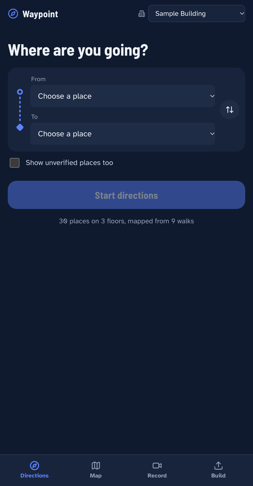
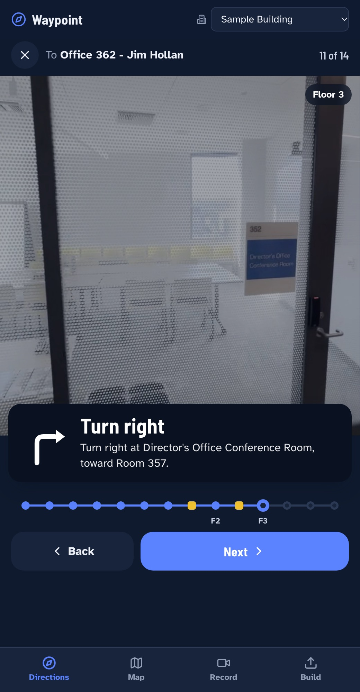
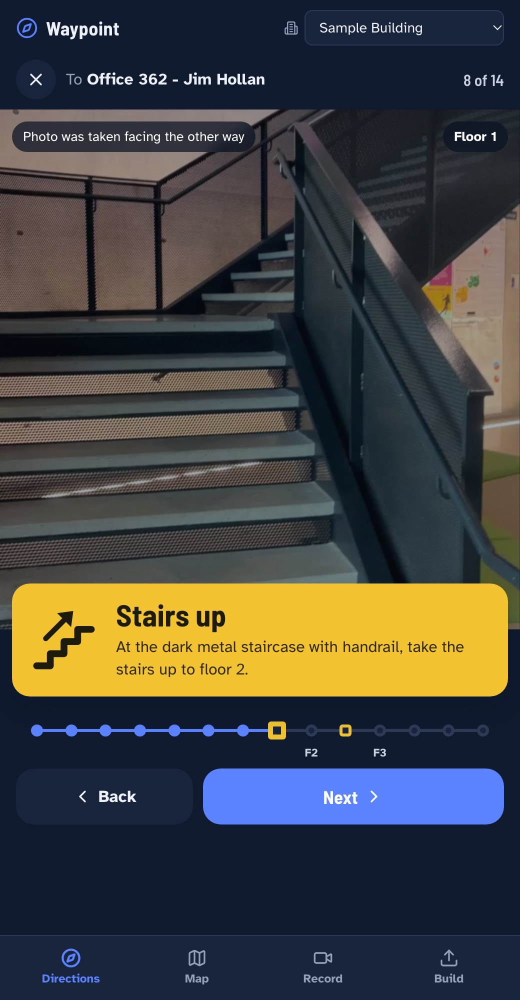
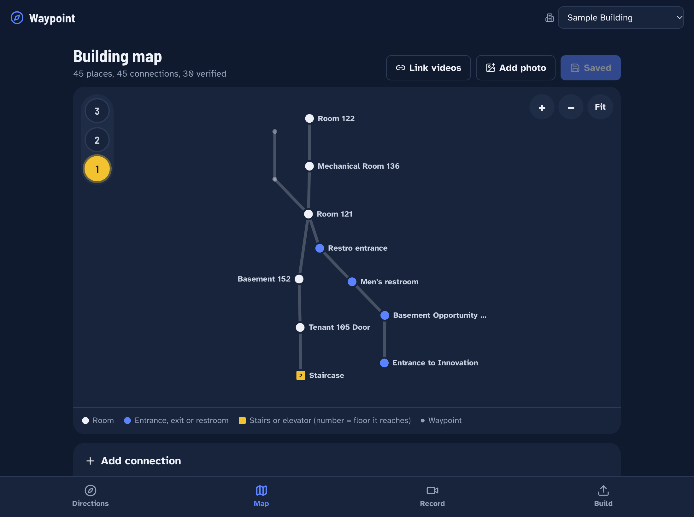
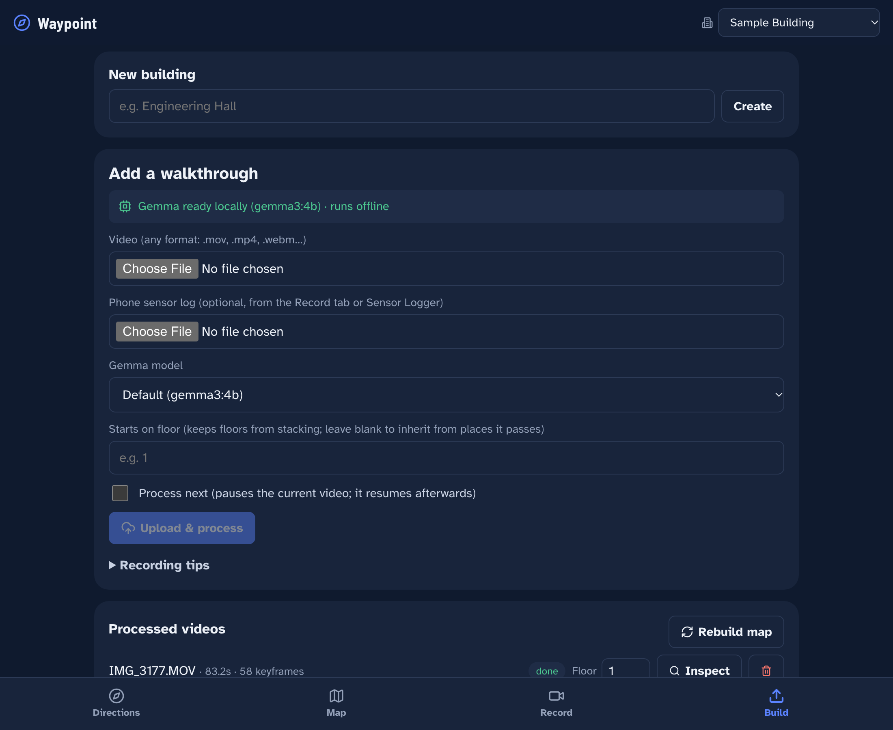

# Waypoint: indoor navigation from a walkthrough video

Record walks through a building on a phone and upload them. **Gemma, running locally and offline**, reads door plaques and signs; on-device OCR checks every word it reports. Computer vision (plus the phone gyro, when available) recovers every turn, glance, and staircase. All videos are merged into **one multi-floor navigation map** that closes loops and links floors through shared stairwells and elevators.

Users pick *From* and *To* on their phone and follow step-by-step photos with wayfinding arrows. Routing at query time is pure graph math, with **no model calls**.

<p align="center">
  
  
  
</p>

<p align="center"><em>Plan a trip, follow photo-and-sign steps, and change floors on the way (floor 1 to Office 362 on floor 3).</em></p>

<p align="center">
  
</p>

<p align="center"><em>One map per floor, built from every walkthrough video. Stairs show the floor they reach.</em></p>

<p align="center">
  
</p>

<p align="center"><em>Upload or record walks; a pausable queue processes them locally with Gemma.</em></p>

```
video ─ffmpeg─▶ analysis.mp4 (10 fps) ─optical flow / gyro─▶ travel heading ─▶ turns / glances / pauses
       └──────▶ hq.mp4 (15 fps) ─adaptive sharpness─▶ keyframes ─OCR + Gemma (local)─▶ signs, rooms, stairs
                                                         │
     walk nodes ─▶ loop closure ─▶ floors (start floor, room numbers, stairs) ─▶ link all videos ─▶ map.json
```

## AI models

**Used by the app (all run locally, offline after one download):**

| Model | Role |
|---|---|
| **Gemma 3 4B** (`gemma3:4b`, Google, open weights, via Ollama) | Default vision-language model. Per keyframe it returns structured JSON: sign text, room numbers, place type, stairs, floor hints and a landmark phrase. It also answers "same place?" and "same stairwell?" when linking walks and floors |
| **Gemma 3 12B** (`gemma3:12b`, optional) | Higher-quality, ~2.5× slower alternative for overnight pre-processing on machines with 32 GB+ |
| **Apple Vision text recognizer** (macOS `VNRecognizeTextRequest`, on-device) | Grounds Gemma: only text this OCR actually found may become a sign or room number, which stops small-model hallucinations. Skipped automatically off macOS |

Everything else is classical computer vision with no learned model: Lucas–Kanade optical flow, RANSAC similarity fits, ORB features and homographies (OpenCV), plus graph search (NetworkX).

**Speed and model choice.** Tested live with `gemma3:4b`: about 5 s per keyframe on Apple Silicon at concurrency 3 (`GEMMA_CONCURRENCY`). Each upload can name its own model (the `model` form field, or `--model` in the CLI). That model is used for every Gemma call on the walk. See *Gemma calls and failures* under Configuration.

**Used to design and build it:** the architecture, pipeline, backend, frontend, tests and this README were designed and implemented with **Claude Opus 5.5** (Anthropic, model ID `claude-opus-5-5`) running in **Claude Code**, working with the team below. The team chose the building, recorded and curated the walkthroughs, tested on site and directed the design.

## Contributors

- Neel
- Evan
- Prachet
- Sudarshan

## Run it

```bash
# one-time setup (needs internet once)
brew install ffmpeg uv cloudflared ollama
ollama pull gemma3:4b            # fast default; gemma3:12b for higher-quality pre-processing

# 1. local model server (parallel requests ~25% faster on Apple Silicon)
OLLAMA_NUM_PARALLEL=4 ollama serve

# 2. backend (serves the API and the built frontend on :8000)
cd backend && uv sync && uv run uvicorn app.main:app --host 0.0.0.0 --port 8000

# 3. frontend: build once into backend/static ...
cd frontend && npm install && npm run build
#    ... or develop with hot reload on :5173 (proxies /api to :8000)
npm run dev

# 4. phone access over HTTPS (needed for camera + gyro on iOS); works on any network
cloudflared tunnel --url http://localhost:8000
```

Open the printed `https://….trycloudflare.com` URL on the phone.

Check the local model with `curl http://localhost:8000/api/health`: `gemma.ok` is true when Ollama answers, and
`gemma.selected` is the model in use. If Ollama is stopped, the reply comes back within a few seconds with `ok: false`. Bookmark `#/navigate?b=<building-id>`,
record new walks at `#/record?b=<building-id>`, or share a route directly with
`#/navigate?b=<building-id>&from=<place-id>&to=<place-id>`.

### Batch pre-processing (no UI)
```bash
cd backend
uv run python -m app.cli ingest "Sample Building" ../IMG_31*.MOV
uv run python -m app.cli route sample-building n001 n012
uv run python -m app.cli rebuild sample-building   # re-run CV + mapping; Gemma answers come from cache (each walk's own model)
# add --model gemma3:12b to ingest for a slower, higher-quality run
```

### Tests
Run from `backend/` after `uv sync` (which also installs pytest):
```bash
cd backend && uv run pytest
# or, with the venv active:  python -m pytest
```
**ffmpeg must be installed** (`brew install ffmpeg`). The tests that run the real normalize step
(`test_pipeline.py`, `test_jobs_pipeline.py`, `test_motion.py`) need it. Other tests do not run it.

The suite has 433 tests. Gemma tests replace the Ollama client, so no model is needed to run them.

They use synthetic videos with a known camera yaw and fixture maps:
- 90° turns are measured to within 0.1°; a glance (look at something and back) is not a turn.
- A 4-turn loop closes into a cycle.
- Routes mirror in reverse, stairs flip up↔down, and "no path" returns HTTP 400.
- Floors from room numbers (121 → 1, 208 → 2), elevator jumps without stairs, one misread number ignored.
- Walks merge across videos by room number or named sign but never across two known floors; guessed floors are
  adopted from linked walks; single staircases on adjacent floors are linked; removing a video keeps
  places other walks still use.
- Uploads over the size limits get 413; `/bfiles` serves frames only; `PUT /map` ignores server-owned fields;
  an out-of-range `start_floor` gets 422; the Gemma cache migrates from the old JSON file and survives a torn last line.
- Gemma: a missing model (404) fails at once; transient errors and bad JSON are retried once; truncated output is
  not retried; the circuit breaker stops calls after repeated failures; a rebuild with Ollama off uses the cache;
  room numbers and floor hints must be grounded in OCR; different plaque numbers block a merge; `/api/health`
  returns quickly when Ollama is down.

## Configuration
Every setting has a default and can be overridden with an environment variable, for example
`MAX_UPLOAD_MB=4096 uv run uvicorn app.main:app --port 8000`. The full list is in `backend/app/config.py`.

| Variable | Default | What it does |
|---|---|---|
| `MAX_UPLOAD_MB` | 2048 | Largest walk video, in MiB. Bigger uploads get HTTP 413 |
| `MAX_SENSOR_BYTES` | 52428800 (50 MiB) | Largest `sensors.json` sent with a video. Bigger gets 413 |
| `MAX_IMAGE_BYTES` | 26214400 (25 MiB) | Largest manually added photo. Bigger gets 413 |
| `GEMMA_MODEL` | gemma3:4b | Model used when an upload names none. `gemma3:12b` is slower and more accurate |
| `GEMMA_KEEP_ALIVE` | 30m | How long Ollama keeps the model loaded after a request. Also `1h`, or seconds (`-1` = forever) |
| `GEMMA_NUM_CTX` | 4096 | Context size sent with every request, so the loaded model is reused |
| `GEMMA_NUM_PREDICT_ANALYZE` | 512 | Answer token cap for frame analysis. A truncated answer fails the call |
| `GEMMA_NUM_PREDICT_COMPARE` | 320 | Answer token cap for "same place?" and "same stairwell?" |
| `GEMMA_LIST_TIMEOUT_SEC` | 3 | Timeout for model list, model check and health calls, so a stopped Ollama fails fast |
| `GEMMA_BREAKER_FAILS` | 3 | Failures in a row before the rest of the walk uses cached answers only |
| `MAX_FLOOR` | 9 | Highest floor number. `start_floor` must be 1 to this value |
| `FLOOR_SIGNS` | 1 | Set to `0` to ignore floor signs and Gemma's floor hints |
| `FLOOR_SIGN_WEIGHT` | 2.0 | Evidence weight of one OCR-confirmed floor sign. A room number weighs 1, and a floor needs 2 |
| `STAIR_LANDING_GAP_S` | 9.0 | Longest gap (seconds) between two same-direction flights that can still be one climb with a landing between. **Untuned guess: tune on real walks** |
| `STAIR_LANDING_MAX_S` | 15.0 | Longer gap (seconds) allowed only when every frame between is a stairwell. **Untuned guess: tune on real walks** |

Set both `STAIR_LANDING_*` values to `0` to count every flight as a floor change.

**Gemma calls and failures**
- Every call uses temperature 0 and the `GEMMA_NUM_*` limits and `GEMMA_KEEP_ALIVE` above.
- **Model check first.** A job checks its model once, before any frame. If the model is not pulled, the log shows
  `Run: ollama pull <model>` and the walk uses cached answers only.
- **Retries.** A dropped connection, a timeout, an HTTP 5xx or unreadable JSON is retried once. A 404 or other 4xx
  fails at once. Truncated output is not retried: raise the matching `GEMMA_NUM_PREDICT_*` value.
- **Bad frames are skipped.** A frame that fails is logged and skipped. The walk goes on.
- **Circuit breaker.** After `GEMMA_BREAKER_FAILS` failures in a row, the rest of that walk uses cached answers
  only, and the job log says so.
- **Cache first.** Each answer is read from `gemma_cache.jsonl` before Ollama is contacted. A rebuild with Ollama
  stopped keeps every Gemma result (the job log says "using cached answers only"). The cache key includes the
  prompt version (now `v6`), so the first rebuild after this upgrade asks Gemma once for each frame and needs Ollama running.
- **Model per walk.** The upload's model is used for every Gemma call of that walk: frame analysis, same-place and
  same-stairwell checks. A rebuild reuses each walk's stored model.
- **Walk record.** `walk.json` records `gemma` (answers exist), `gemma_frames_ok` (frames analysed) and `model`
  (the model actually used). The map's `processed_with` holds the model of the last walk Gemma processed.

**Limits and API behaviour**
- Uploads over a limit get HTTP 413, and the partial file is deleted. A request whose declared size is more than
  the video limit + the sensor limit + 1 MiB is refused before the body is read.
- `/bfiles/<building>/frames/<file>` serves keyframe photos only. The map, the Gemma cache and the videos are
  not downloadable.
- `start_floor` (on upload, or with `PATCH /api/buildings/<id>/videos/<video>`) must be 1 to `MAX_FLOOR`. Other
  values get HTTP 422.
- `PUT /api/buildings/<id>/map` takes only `nodes` and `edges`, and both are required (a body missing either gets
  422). Videos, processing status and suggested merges come from the server.
- Merging two places on different known floors, by hand or by accepting a suggestion, returns HTTP 400.

## How it works

| Stage | What happens |
|---|---|
| **Normalize** | ffmpeg converts any input (iPhone HEVC `.MOV` with rotation, WebM, MP4) into constant-frame-rate H.264 copies with rotation applied |
| **Motion** | Lucas–Kanade corners plus a RANSAC similarity fit in centred coordinates. Horizontal shift gives **yaw**; expansion gives **forward motion**. The **travel heading** is a running median over frames that move forward and look ahead, so standing and looking around never counts as a turn. If a phone gyro log is attached, it replaces vision yaw, with its sign auto-calibrated against vision |
| **Events** | *Turn*: a sustained change in travel heading. *Glance*: the camera points more than 35° off the travel direction (usually at a plaque). *Pause*: the camera is nearly still |
| **Keyframes** | Event-driven (before and after turns, glances, pauses, scene changes, plus a 3 s heartbeat). In each ±0.5 s window, pick the frame with the highest sharpness relative to the video's own rolling median, divided by motion. Blurry-only windows still keep their best frame, flagged `soft`, so no place is ever lost |
| **Gemma + OCR** | On-device OCR lists the text really present; Gemma returns structured JSON (sign text, room numbers, label, place type, stairs, floor, landmark phrase) and may only copy text from that list. Labels built on an unverified number are rebuilt. Without OCR (non-macOS) Gemma re-reads unclear signs with zoomed crops; with OCR, OCR reads the same crops. All answers are cached on disk. See *How Gemma answers are checked* |
| **Mapping** | Turns, pauses, signs, and stair boundaries become nodes; consecutive frames of one named place collapse. Revisits are detected by room-number text and ORB homography, verified by Gemma ("same physical spot?"); automatic merges need geometric agreement, others go to a review queue. Places with different plaque numbers never merge. Each verified match constrains heading drift (fit `c0 + k·t`). Edge headings are snapped to the building's dominant axis (Manhattan prior) |
| **Floors** | Floors start at 1. A walk's floor comes from its start floor, confirmed room numbers and floor signs, and detected stairs; a floor change without visible stairs inserts a flagged stairs/elevator link. Places on two different known floors never merge. Details below |
| **One map from n videos** | After every video: same room number or same named sign on the same floor ⇒ same place (even when walked in opposite directions); strong ORB or ORB + Gemma matches across walks; walks with a guessed floor adopt the floor of a known place they share; unanchored walks are rotated into the building frame; the same stairwell or elevator on adjacent floors is linked |
| **Routing** | `turn = heading_out(next) − heading_in(arrival)`, quantized to straight, slight, turn, or u-turn. Walking an edge backwards uses headings + 180° and stairs up↔down, so one recording works in both directions. Floor changes say "take the stairs up to floor 2"; across a link between two separate walks the step says where to head instead of guessing a turn. Each step shows the photo taken while approaching that point *in your direction of travel* |
| **App** | Directions: full-bleed photo with a wayfinding sign (bent-arrow pictograms, stair yellow for floor changes) and a route strip. Map: per-floor schematic with an elevator-style floor selector, pan/zoom, merge review and editing. Build: pausable processing queue (run next, resume, survives restarts), per-video start floor, video removal |

## How Gemma answers are checked
- **Grounded in OCR.** A word or number counts only if OCR read it as a whole token. `ROOM 12` does not confirm room `121`.
- **Room numbers.** `RM 118` and `ROOM-118` become `118`. `118A` is kept. Numbers from posters, phone numbers, dates
  and prices are dropped.
- **Directional signs.** `ROOMS 120-130 →` names rooms down the hall, so it never gives this place a room number. The
  text stays in the place's texts.
- **Floors.** A floor hint needs a floor word: `LEVEL 2`, `2ND FLOOR` or `FL2`. A bare number is not enough. If Gemma
  leaves the floor hint empty, the floor comes from an OCR floor sign. Negative and basement floors (`LEVEL -1`,
  `BASEMENT`) are rejected.
- **Labels.** Poster and phone text never becomes a room number or a label.
- **Photos.** Phone EXIF rotation is applied before analysis. OCR reads the full frame and zoomed left and right
  crops, so small plaques at the edges are read.
- **Merges.** Places with different room or plaque numbers never merge automatically, whatever the image match. OCR
  checks the plaques, and Gemma is not asked. A Gemma "different" no longer blocks a strong ORB match when no plaques
  conflict, because gemma3:4b was unreliable at same-place calls. Manual merges skip this check. The floor rule still applies.
- **Known limits.** gemma3:4b can call a blank corridor or an EXIT sign "same place". That alone never merges two
  places; a geometric match is still needed. A rebuild drops manually added photo nodes. An upload whose model is
  not pulled still registers as a video, processed from motion only.

## How floors work
- **Confirmed evidence only.** A walk gets a floor from two room numbers that agree, or from one floor sign that OCR confirmed (`LEVEL 2`, `2ND FLOOR`, `FL2`). One reading is not enough. Without OCR (non-macOS) a floor sign counts as a weak reading, so it needs a second one.
- **Ignored readings.** Basement rooms (`B112`), hyphenated numbers (`2-105`), and 4-digit numbers (usually phone extensions) are not floor evidence. A sign that names several floors (a directory) is ignored too.
- **Stairs.** A staircase with a landing counts one floor per storey, not one per flight. Stairs link two floors only from a real climb or from a place typed as stairs. Gemma's "different stairwell" answer is respected. One exception: a single staircase on each of two adjacent floors is linked as a guess, flagged "check" in the log, and Gemma can still veto it.
- **Climbs from motion.** Gemma often calls a whole flight "stairs ahead". The camera motion also measures the climb: the scene keeps sliding vertically, or the camera tilts down the flight and holds it. This counts only when Gemma saw stairs near it, so a flat walk never changes floor from motion alone. A floor sign read in the few seconds before a climb, such as `LEVEL 2` seen from the bottom, is not evidence for either floor. Thresholds: `CLIMB_*` in `config.py`.
- **Unknown start floor.** A walk with no start floor takes its floor from confirmed evidence, or from a match to a known place. A room-number or named-sign match sets the floor at once. A single look-alike place (for example, identical elevator lobbies) does not: two different places on the same floor are needed.
- **Merging.** Places on two different known floors cannot merge. The API returns 400 with the reason. A guessed floor never blocks a merge; the guessed place takes the known floor.
- **Layout.** Stairs and elevators sit at the same x/y on every floor they connect, so floors stack directly above each other on the map.

## Recording tips
- 1080p with stabilization on. Hold the phone upright and point it where you walk. Turn at a steady pace.
- **Pause about 1 s** at plaques, junctions, and stairs. Glancing at a plaque and back is fine.
- Walk corridors in both directions when you can, and pass known spots again to close loops.
- Best accuracy: record from the **Record** tab on the phone, which logs the gyro alongside the video, and
  enter the floor the walk starts on.
- Overlap something already mapped (a room number, named sign or staircase) so the walk links into the map.
- Film staircases from both floors and **climb them**, so the climb is recorded and the floors link.
- After arriving on a new floor, point the camera at a room number or floor sign within a few seconds.
  That is what corrects the stair count.
- Known limits: elevators with no visible sign may not be detected as a floor change; a climb of several
  storeys with no sign on arrival counts as one floor; basements are not modelled.

## Persistence
Each building is a portable folder, `backend/data/buildings/<id>/`:
- `map.json`: the graph, plus `processed_with` (model and prompt version of the last Gemma-processed walk)
- `frames/`: photos users see
- `gemma_cache.jsonl`: Gemma answers, one JSON line per answer. Each new answer is appended. The file is only
  rewritten to remove duplicates when it is loaded. An old `gemma_cache.json` is converted the first time the cache is used, and kept as `gemma_cache.json.bak`
- `videos/<vid>/`: normalized video, track, `walk.json` (keyframes, events, `gemma`, `gemma_frames_ok`, `model`)

Only `frames/` is served over HTTP (`/bfiles/<id>/frames/<file>`). The rest stays on disk.

Copy the folder to the demo machine and everything works offline.
